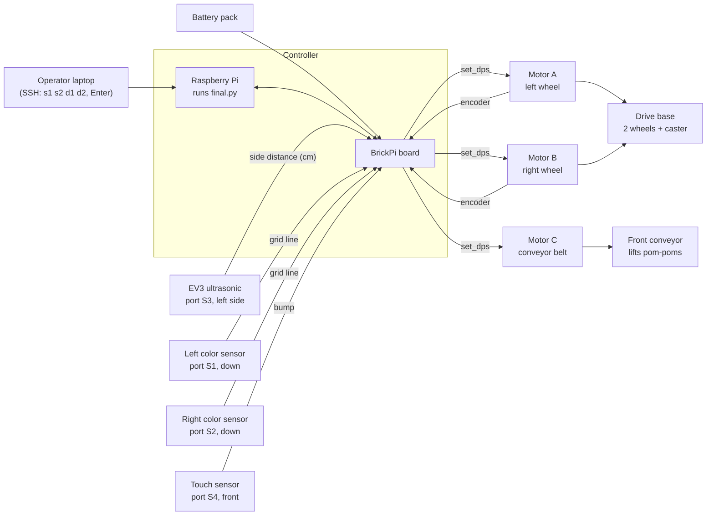
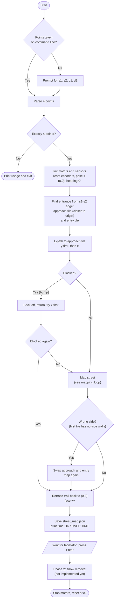
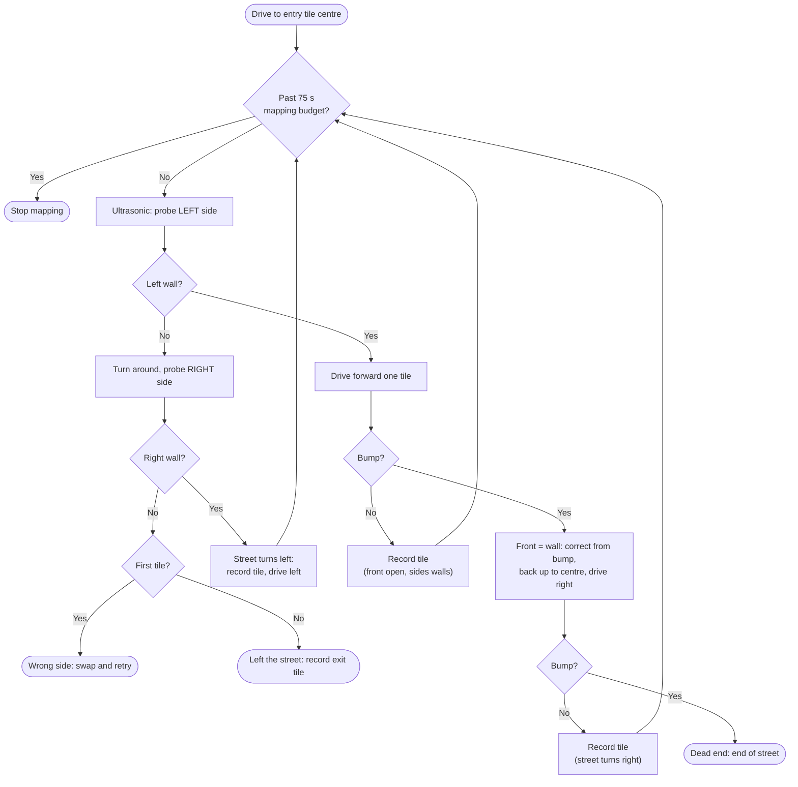
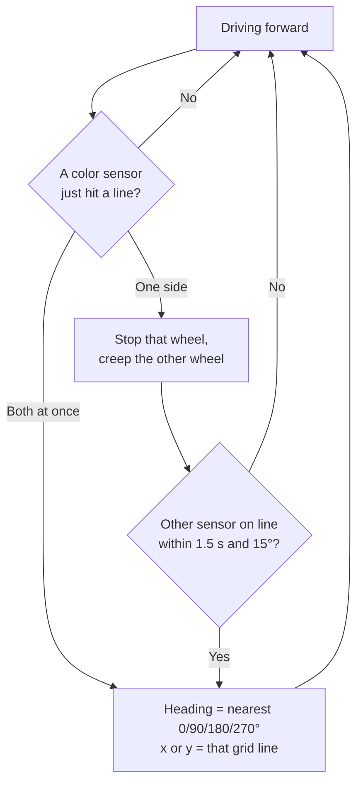

# ECSE 211 Final Project – Snow Removal Robot

An autonomous robot that maps a city street (Phase 1) and then carries the "snow" (pom-poms) out of it using a front conveyor belt (Phase 2).

> **Status:** Phase 1 (mapping) is implemented. Phase 2 (snow removal) is a placeholder.

---

## Hardware

| Part                        | Port | Notes                                             |
|-----------------------------|------|---------------------------------------------------|
| Left drive motor            | A    | Mounted backwards (negative dps = forward)        |
| Right drive motor           | B    | Mounted backwards (negative dps = forward)        |
| Conveyor belt motor         | C    | Picks up pom-poms (Phase 2), idle in Phase 1     |
| Left color sensor           | S1   | Looks down, detects the black grid lines         |
| Right color sensor          | S2   | Looks down, detects the black grid lines         |
| EV3 ultrasonic sensor       | S3   | On the **left side**, measures the wall beside the robot |
| Touch sensor                | S4   | On the front, bump detection (a press = wall ahead) |

If the ultrasonic is on the right side instead, set `US_SIDE = 1`.

All ports and dimensions are constants at the top of `final.py`. Change them there if your build is different.

---

## Running

The robot only gets **four points** from the facilitator: `s1`, `s2` (the street entrance) and `d1`, `d2` (the snow drop-off). Each point is `x,y` in grid units.

```bash
# pass the points on the command line: s1 s2 d1 d2
python3 final.py 1,3 1,2 2,-1 3,-1

# or run with no arguments and it will ask for each point
python3 final.py
```

`(1,3)` and `1 3` are also accepted for a point. The program stops with a usage message if it doesn't get exactly four points.

### Demo procedure

1. Place the robot on the origin `(0,0)`, **facing +y** (toward the top of the map).
2. Start the program with the four points from the facilitator.
3. **Phase 1** runs: the robot maps the street and comes back to the origin.
4. The program pauses with `Waiting for facilitator. Press Enter to start Phase 2...`.
5. When the facilitator has added the snow and says to go, press **Enter**.
6. Press **Ctrl+C** at any time to stop the robot safely (motors stop and the brick resets).

---

## Coordinate system

- The map is a 9 × 5 grid of 30.48 cm tiles. Valid intersections are x ∈ [−1, 8], y ∈ [−1, 4].
- `(0,0)` is the lower-left intersection; the inputs `s1, s2, d1, d2` are intersections.
- Tile `(i, j)` is the square whose lower-left corner is `(i, j)`. Its centre is `(i + 0.5, j + 0.5)`.
- Heading: **0° = +y, 90° = +x**, increasing clockwise.
- Odometry is tracked in cm.

---

## Phase 1: mapping

1. **Find the entrance.** `s1`–`s2` is a one-tile edge with a tile on each side. The tile closer to the origin is the *approach tile* and the other one is the first street tile.
   Example (sample map, `s1=(1,3)`, `s2=(1,2)`): approach tile `(0,2)`, first street tile `(1,2)`, heading in = 90° (+x).
2. **Drive to the approach tile** with an L-shaped path (y first, then x). If the bumper hits something, the robot backs off, goes back and tries x first.
3. **Walk the street one tile at a time.** The street is one tile wide with no branches, so on each tile:
   - The **side ultrasonic** checks the wall on its side (left). A reading below `WALL_THRESHOLD` (≈ 22 cm) is a wall, and it also corrects the robot's position across the street.
   - **Side wall:** the robot tries to drive **forward** one tile. If the **bumper** hits, the front is a wall. It corrects its position from the bump, backs up to the tile centre and tries the **other side**. Another bump means a dead end. Touching the walls is allowed in Phase 1.
   - **Side open:** the robot turns around to point the ultrasonic at the other side. If that side is open too, the robot has left the street. If not, the street turns toward the open side.
4. **Grid-line correction.** Every time a color sensor crosses a black grid line while driving forward, that wheel stops. The other wheel keeps creeping until its sensor reaches the line too. The robot is then square to the line, so it resets its heading to 0/90/180/270° and its x or y to that line.
5. **Stop mapping** when one of these happens:
   - the robot is on a tile with **no wall on either side** (it has left the street), which is recorded as the exit tile,
   - a dead end,
   - the street reaches the map edge,
   - the next tile was already visited,
   - the 75 s mapping budget (`MAPPING_BUDGET`) runs out, which leaves time to get home within the 2-minute limit.

   If the *first* street tile has no side walls, the entrance side was guessed wrong. The robot swaps sides and starts mapping again.
6. **Return to the origin** by retracing its own path in reverse. Straight runs are merged into one move. At the end it turns to face +y.
7. **Save the map** to `street_map.json`.

### `street_map.json`

```json
{
  "s1": [1, 3], "s2": [1, 2], "d1": [2, -1], "d2": [3, -1],
  "approach_tile": [0, 2],
  "entry_tile": [1, 2],
  "entry_heading": 90,
  "street": [
    {"tile": [1, 2], "walls": {"0": true, "90": false, "180": true}},
    ...
  ],
  "exit_tile": [5, -1],
  "street_length_tiles": 7
}
```

- `street`: the street tiles in order from the entrance. `walls` maps each heading (as a string) to `true` if there is a box in that direction.
- `exit_tile`: the first open tile past the end of the street, or `null` if the street ended in a dead end, at the map edge, or because time ran out.

Phase 2 will read this map.

---

## Phase 2: snow removal

Not implemented yet. `run_phase2(street_map)` gets the Phase 1 map once the facilitator gives the go-ahead.

---

## Flowcharts

### Hardware



### Program flow



### Phase 1 mapping loop



### Grid-line correction (while driving forward)



---

## Calibration checklist

Check these values in `final.py` on the real robot before a demo:

| Constant          | Default | How to check                                                                 |
|-------------------|---------|------------------------------------------------------------------------------|
| `RADIUS`          | 2.13 cm | Drive 100 cm by odometry and measure the real distance; scale to match.      |
| `TRACK_WIDTH`     | 14.5 cm | Command a 360° turn; increase it if the robot over-turns, decrease if it under-turns. |
| `MOTOR_DIR`       | −1      | Robot should drive *forward* on a positive `set_wheels`.                     |
| `US_SIDE`         | −1 (left) | Side the ultrasonic faces: −1 = left, 1 = right.                           |
| `US_SIDE_OFFSET`  | 8.0 cm  | Measure from the robot centre to the face of the side ultrasonic.            |
| `WALL_THRESHOLD`  | `TILE − US_SIDE_OFFSET` | From a tile centre, a wall should read about 7 cm and an open side more than 38 cm. |
| `COLOR_OFFSET`    | 3.0 cm  | How far the color sensors are ahead of the wheel axle (negative if behind).  |
| `LINE_THRESHOLD`  | 200     | Print `left_color.get_value()` over the floor and over a line; pick a value between them. |
| `BUMPER_OFFSET`   | 14.0 cm | Measure from the robot centre to the front of the touch sensor.              |
| Sensor ports      | S1–S4   | `LEFT_COLOR_PORT`, `RIGHT_COLOR_PORT`, `ULTRASONIC_PORT`, `TOUCH_PORT` must match the cables. |
| `DRIVE_DPS` / `TURN_MAX_DPS` | 300 / 280 | Raise them if Phase 1 runs close to the 2-minute limit, lower them if it slips. |
| `MAPPING_BUDGET`  | 75 s    | Lower it if the trip home pushes Phase 1 past 120 s.                         |

The program prints its time at the end of Phase 1 and says `OK` or `OVER TIME`.

---

## Files

| File                          | Purpose                                     |
|-------------------------------|---------------------------------------------|
| `final.py`                    | Robot program (Phase 1 + Phase 2 stub)      |
| `street_map.json`             | Generated by Phase 1                        |
| `ECSE211_F26_Project-1.pdf`   | Project specification                       |
